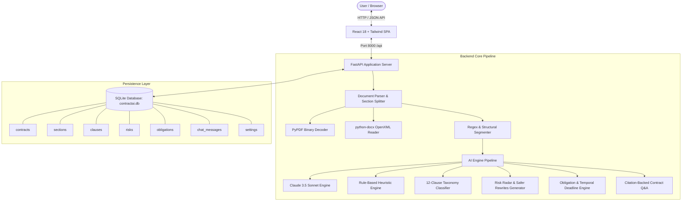
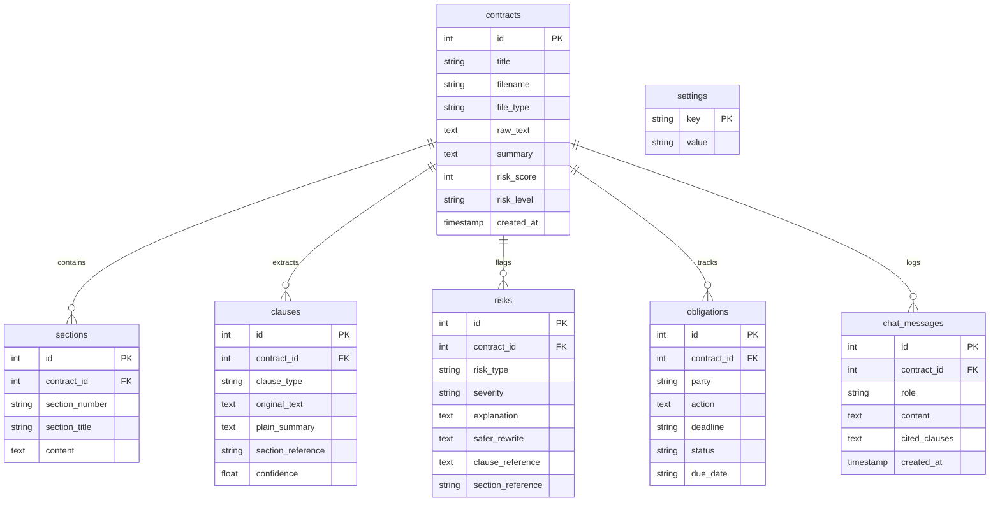

# ContractAI System Architecture & Engineering Specification

## 1. High-Level Architecture Overview
ContractAI is engineered with a decoupled client-server architecture:
- **Presentation Layer**: React 18 single-page application styled with Tailwind CSS, utilizing Lucide icons and modern responsive layout principles.
- **API & Application Layer**: Python FastAPI ASGI framework exposing asynchronous REST endpoints with Pydantic type validation.
- **Intelligence Layer**: Dual-mode AI engine incorporating Anthropic Claude 3.5 Sonnet (for cloud LLM execution) and an offline deterministic heuristic NLP engine (for zero-cost, instant local viva execution).
- **Persistence Layer**: Relational SQLite3 database with cascading constraints, foreign keys, and JSON support.

---

## 2. Agent Processing Pipeline (4-Stage Pipeline)

### Stage 1: READ (Ingest & Structural Segmentation)
- **Input Formats**: PDF, DOCX, and raw UTF-8 string.
- **Section Parsing**: Contract text is split into numbered legal sections utilizing hierarchical regular expressions:
  - Level 1: `(?:SECTION|ARTICLE|CLAUSE)\s+([0-9IVXLCDM]+)[\.\:\-\s]+(.*)`
  - Level 2: `([0-9]{1,2}(?:\.[0-9]{1,2})*)\.?\s+([A-Z][A-Za-z0-9\s,\-\/\(\)]+)`
  - Level 3: Known legal headings (`DEFINITIONS`, `TERMINATION`, `INDEMNITY`, etc.)

### Stage 2: EXTRACT (12-Clause Taxonomy Classification)
Every section is scanned and classified into exactly one of 12 legal categories:
1. `Payment`
2. `Term & Renewal`
3. `Termination`
4. `Confidentiality`
5. `Liability`
6. `Indemnification`
7. `Non-Compete`
8. `IP` (Intellectual Property)
9. `Governing Law`
10. `Dispute Resolution`
11. `Warranty`
12. `Force Majeure`

For each clause, the system synthesizes a **Plain-English Summary** explaining the clause mechanics in non-lawyer terms.

### Stage 3: DETECT (Risk Radar, Severity Classification & Safer Rewrites)
The engine scans for predatory, dangerous, or one-sided contract provisions:
- **Unlimited Liability**: Detects uncapped damages clauses and flags as **High Severity**.
  - *Rewrite*: Capped to aggregate fees paid in prior 12 months.
- **Auto-Renewal Traps**: Detects evergreen renewal clauses requiring 60–90+ days advance non-renewal notice.
  - *Rewrite*: Affirmative mutual written agreement required to renew.
- **One-Sided Termination**: Detects unilateral termination for convenience.
  - *Rewrite*: Mutual 30-day termination for convenience.
- **Broad Indemnification**: Detects failure to carve out counterparty negligence.
  - *Rewrite*: Limited strictly to direct material breaches, excluding counterparty faults.
- **Harsh Penalties**: Detects liquidated damages and steep interest charges.
  - *Rewrite*: Limited to actual direct out-of-pocket costs.
- **Perpetual Obligations**: Flags indefinite secrecy or non-competes.
  - *Rewrite*: 3-year survival term.

#### Risk Scoring Formulation:
$$\text{Score} = \min\left(98, \; 15 + (24 \times N_{\text{high}}) + (12 \times N_{\text{medium}}) + (6 \times N_{\text{low}})\right)$$

### Stage 4: TRACK (Obligations & Temporal Deadlines)
- Identifies deontic modal verbs (`shall`, `must`, `agrees to`).
- Extracts responsible entities: `Client`, `Service Provider`, `Receiving Party`, or `Both Parties`.
- Extracts condition/deadline: `Net 15`, `Within 10 business days`, `90 days prior to term`.
- State machine: `Pending` $\to$ `Done` $\to$ `Overdue`.
- Generates simulated calendar due dates for chronological timeline display.

### Stage 5: CHAT (Citation-Backed Q&A)
- Accepts freeform questions: *"When can I cancel?"*, *"What is my liability cap?"*.
- Identifies candidate clauses through taxonomic mapping and semantic keyword relevance.
- Extracts supporting quotes and displays direct section references.

---

## 3. Database Schema (SQLite)

---

## 4. API Endpoints Specification

| Method | Endpoint | Description |
| :--- | :--- | :--- |
| `GET` | `/api/contracts` | List all ingested contracts with summary metadata |
| `GET` | `/api/contracts/{id}` | Retrieve full analysis (sections, clauses, risks, obligations) |
| `POST` | `/api/contracts/upload` | Ingest PDF/DOCX or text, execute agent pipeline, save to DB |
| `DELETE` | `/api/contracts/{id}` | Delete contract and cascade-delete all related records |
| `PATCH` | `/api/obligations/{id}/status` | Update obligation status (`Pending`, `Done`, `Overdue`) |
| `POST` | `/api/contracts/{id}/chat` | Ask question, receive answer with cited clauses |
| `GET` | `/api/contracts/{id}/chat` | Fetch full chat history for contract |
| `GET` | `/api/samples` | List available pre-loaded contract templates |
| `POST` | `/api/samples/load/{sample_id}` | Load and analyze sample contract in 1 click |
| `GET` | `/api/samples/download/{file}` | Download sample `.docx` or `.pdf` file |
| `GET` | `/api/dashboard/stats` | Aggregated metrics for portfolio KPI cards |
| `GET` | `/api/settings` | Get current AI engine mode and key status |
| `POST` | `/api/settings` | Configure AI engine mode and Anthropic API key |
