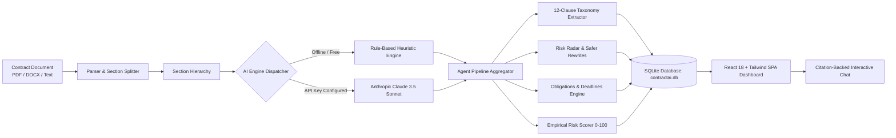

# ContractAI — AI Agent for Contract Management & Risk Analysis

[](https://fastapi.tiangolo.com/)
[](https://reactjs.org/)
[](https://tailwindcss.com/)
[](https://sqlite.org/)
[](https://opensource.org/licenses/MIT)

**ContractAI** is a complete, working autonomous AI agent application engineered for small business owners, legal operations teams, and procurement managers who are not lawyers. 

It executes an automated 4-stage legal intelligence pipeline:
1. 📖 **READS** contracts from PDF, DOCX, or pasted text and splits them into numbered legal sections.
2. 🏷️ **EXTRACTS** key clauses across 12 standardized categories and provides plain-English summaries.
3. ⚠️ **DETECTS** predatory legal risks (uncapped liabilities, auto-renewal traps, broad indemnities) with severity badges, safer rewrites, and an empirical risk score (0–100).
4. ⏱️ **TRACKS** actionable obligations, responsible entities, and upcoming calendar deadlines.
5. 💬 **CHATS** with contracts, answering freeform queries while strictly quoting and citing relevant contract clauses.

---

## Table of Contents
- [Product Architecture](#product-architecture)
- [Folder Structure](#folder-structure)
- [Step-by-Step Setup and Run Instructions](#step-by-step-setup-and-run-instructions)
- [Testing with Sample Contracts](#testing-with-sample-contracts)
- [Core Features & UI Walkthrough](#core-features--ui-walkthrough)
- [Exact Prompts Used](#exact-prompts-used)
- [Rule-Based Fallback Engine (Offline Mode)](#rule-based-fallback-engine-offline-mode)
- [Limitations & Future Enhancements](#limitations--future-enhancements)
- [Academic Semester Project Report Outline](#academic-semester-project-report-outline)

---

## Product Architecture



---

## Folder Structure

```text
contractai/
├── backend/
│   ├── main.py                  # FastAPI server, REST API endpoints, static file mounting
│   ├── database.py              # SQLite schema, tables (contracts, sections, clauses, risks, obligations)
│   ├── models.py                # Pydantic data schemas & request/response models
│   ├── parser.py                # Document parsers (PyPDF, python-docx) & section splitter regex
│   ├── ai_engine.py             # Claude structured JSON prompts & Rule-Based Heuristic engine
│   ├── sample_contracts.py      # Real contract templates (MSA, NDA, SaaS) & PDF/DOCX generators
│   ├── contractai.db            # SQLite database file
│   └── sample_data/             # Pre-generated test contracts (.docx and .pdf files)
│       ├── sample_msa_contract.docx
│       ├── sample_msa_contract.pdf
│       ├── sample_nda_contract.pdf
│       └── sample_saas_agreement.docx
├── frontend/
│   ├── index.html               # Main HTML entrypoint with Plus Jakarta Sans & JetBrains Mono
│   ├── package.json             # React 18, Vite 5, Tailwind CSS, Lucide icons
│   ├── vite.config.js           # Vite configuration with API proxy to port 8000
│   ├── tailwind.config.js       # Tailwind CSS configuration with dark mode support
│   ├── postcss.config.js        # PostCSS configuration
│   ├── dist/                    # Production built bundle served directly by FastAPI
│   └── src/
│       ├── main.jsx             # React DOM root
│       ├── App.jsx              # Main view state router & theme controller
│       ├── index.css            # Tailwind directives and custom scrollbars
│       ├── api.js               # Frontend API client communicating with FastAPI
│       └── components/
│           ├── Navbar.jsx               # Navigation bar, sample loader, dark mode, disclaimers
│           ├── LandingPage.jsx          # Hero section, 4-step pipeline cards, 12-clause showcase
│           ├── DashboardView.jsx        # Portfolio KPI cards, risk distribution bar, contracts table
│           ├── IngestView.jsx           # File upload dropzone, paste text, preloaded samples carousel
│           ├── ContractDetailView.jsx   # 5-Tab detail viewer (Clauses, Risks, Obligations, Chat, Sections)
│           ├── SettingsModal.jsx        # Switch between Rule-Based Heuristics & Claude 3.5 Sonnet
│           └── ArchitectureModal.jsx    # Viva project architecture diagram and oral defense cheat-sheet
├── start.bat                    # One-click Windows startup script
├── start.sh                     # One-click Linux/macOS startup script
├── ARCHITECTURE.md              # Technical system design, Mermaid diagrams, DB ERD
├── PROJECT_REPORT.md            # Complete academic semester project report
└── README.md                    # Project documentation (this file)
```

---

## Step-by-Step Setup and Run Instructions

### Prerequisites
- **Python**: Version 3.10+ (tested on Python 3.13)
- **Node.js**: Version 18+ (tested on Node.js v20)

### 1. Instant Windows Launch (Recommended)
Double-click `start.bat` in the project root directory.  
This will:
1. Verify the Python packages.
2. Launch the FastAPI server on `http://127.0.0.1:8000`.
3. Open your default web browser to the ContractAI dashboard.

### 2. Manual Terminal Launch

#### Option A: Unified Setup (FastAPI serves pre-built React frontend)
```bash
# Navigate to backend directory
cd contractai/backend

# Install required Python libraries
pip install fastapi uvicorn python-multipart pypdf python-docx aiosqlite httpx reportlab anthropic

# Start the unified web server
python -m uvicorn main:app --host 127.0.0.1 --port 8000 --reload
```
Open your browser to: **`http://localhost:8000`**

#### Option B: Full-Stack Development Mode (Independent Hot-Reload)
**Terminal 1 (Backend)**:
```bash
cd contractai/backend
python -m uvicorn main:app --host 127.0.0.1 --port 8000 --reload
```

**Terminal 2 (Frontend)**:
```bash
cd contractai/frontend
npm install
npm run dev
```
Open your browser to: **`http://localhost:5173`** (Vite automatically proxies `/api` calls to port 8000).

---

## Testing with Sample Contracts

ContractAI comes pre-packaged with 3 realistic contract archetypes designed to test all risk detection algorithms:

1. **Master Services Agreement (MSA)**:
   - *Format*: Available as `.docx`, `.pdf`, or 1-click load in the UI.
   - *Key Risks Planted*: Uncapped client liability, 90-day evergreen auto-renewal trap, 14-day unilateral provider termination, and broad indemnity.
   - *Risk Score*: **98/100 (High Risk)**.
2. **Mutual Non-Disclosure Agreement (NDA)**:
   - *Format*: Available as `.pdf` or 1-click load in the UI.
   - *Key Risks Planted*: Perpetual secrecy survival term and $250,000 liquidated damages penalty clause.
   - *Risk Score*: **57/100 (Medium Risk)**.
3. **Enterprise SaaS Subscription SLA**:
   - *Format*: Available as `.docx` or 1-click load in the UI.
   - *Key Risks Planted*: Unilateral terms modification rights and total "as-is" warranty disclaimers.
   - *Risk Score*: **45/100 (Medium Risk)**.

---

## Core Features & UI Walkthrough

### 1. Landing Page
- **Hero Banner**: "AI Contract Intelligence for Non-Lawyers".
- **Autonomous Pipeline Flow**: Step-by-step visual representation of the 4-phase agent pipeline.
- **12-Clause Showcase**: Badges detailing every recognized legal domain.
- **Instant Demo CTAs**: One-click sample analysis and direct navigation to the upload portal.

### 2. Portfolio Dashboard
- **Executive Metric Cards**: Total Ingested Agreements, Average Portfolio Risk Score gauge, Risks Flagged counter, and Active Tracked Obligations.
- **Risk Tier Distribution**: Color-coded breakdown of High (Red), Medium (Amber), and Low (Green) risk contracts.
- **Contracts Table**: List of all processed contracts with file type badge, date, clause count, and 1-click inspection.

### 3. Ingestion Portal
- **Drag-and-Drop Uploader**: Native support for Adobe PDF (`.pdf`), Microsoft Word (`.docx`), and plain text (`.txt`).
- **Raw Text Paste**: Paste custom terms or contract clauses with character count tracking.
- **Preloaded Samples Carousel**: One-click instant loading and document downloads.
- **Animated Stepper**: Real-time 4-step progress animation while analyzing.

### 4. Comprehensive Contract Analysis (5 Tabs)
1. **Clause Extraction Tab**:
   - Filter clauses by 12 categories or search for specific terms.
   - Each card displays category badge, section number, confidence score, and a **Plain-English Summary** for non-lawyers.
   - Expandable original legal language excerpt.
2. **Risk Radar & Safer Rewrites Tab**:
   - Displays all flagged liabilities with High/Medium/Low severity badges.
   - Non-lawyer plain-English explanation of why the clause is dangerous.
   - **Suggested Safer Rewrite**: Ready-to-copy balanced contract substitute with a 1-click "Copy Clause" button.
3. **Obligations & Deadlines Tab**:
   - Identifies responsible party (Client, Service Provider, etc.), action required, and deadline.
   - Dual View Modes: **Interactive Checklist** (toggle status between Pending, Done, Overdue) and **Chronological Timeline**.
4. **Chat with Contract Tab**:
   - Interactive conversational assistant for freeform inquiries (e.g. *"When can I cancel?"*, *"Is my liability capped?"*).
   - Assistant responses feature **explicit clause citations**, quoting the exact sentence from the contract.
5. **Full Numbered Sections Tab**:
   - Clean, numbered section viewer with keyword search filtering.

### 5. Settings & Viva Guide Modals
- **Settings Modal**: Switch seamlessly between the Offline Rule-Based Heuristic engine (free & offline) and Claude 3.5 Sonnet.
- **Viva Guide Modal**: Architectural diagrams, exact prompt listings, and viva exam defense Q&A.

---

## Exact Prompts Used

### 1. Extraction & Analysis Prompt (Claude 3.5 Sonnet)
```text
System Prompt:
You are ContractAI, an expert AI legal contract analyst specializing in helping small business owners, legal teams, and procurement managers who are NOT lawyers.

Your job is to read the provided contract text and output a structured JSON analysis containing:
1. Executive Summary: 2-3 sentences explaining the nature and scope of the agreement.
2. Clauses: Extract and classify key clauses into exactly one of these 12 categories:
   Payment, Term & Renewal, Termination, Confidentiality, Liability, Indemnification, Non-Compete, IP, Governing Law, Dispute Resolution, Warranty, Force Majeure.
   For each clause provide: clause_type, original_text, plain_summary, section_reference, confidence (0.0 to 1.0).
3. Risks: Identify dangerous wording (unlimited liability, auto-renewal, one-sided termination, broad indemnity, penalties, perpetual obligations).
   Provide: risk_type, severity (High/Medium/Low), explanation, safer_rewrite, clause_reference, section_reference.
4. Obligations: Extract actionable duties (party, action, deadline, status: "Pending").
5. Overall Risk Score: Integer from 0 (Safe) to 100 (Extremely Dangerous/Predatory).

Respond ONLY with valid JSON.
```

### 2. Conversational Q&A with Clause Citation Prompt
```text
System Prompt:
You are ContractAI Assistant. You answer questions from users about their contract.
Crucial rules:
1. Always cite the exact Section Number and Clause Type relevant to the answer.
2. Provide a clear, direct answer in plain English for non-lawyers.
3. Quote the specific sentence or phrase from the contract that supports your answer.
4. Add a quick practical recommendation if the clause poses a risk.
5. If the contract does not mention the topic, clearly state that it is not covered.
Include a JSON block at the end with cited clauses:
```json
[
  {
    "clause_type": "Termination",
    "section_reference": "Section 4",
    "quote": "Either party may terminate upon 30 days written notice...",
    "explanation": "Allows termination for convenience with 30 days notice."
  }
]
```
```

---

## Rule-Based Fallback Engine (Offline Mode)

ContractAI includes a deterministic heuristic NLP engine in `backend/ai_engine.py`:
- **Regular Expression Pattern Banks**: Maps complex legal terminology across all 12 clause categories.
- **Risk Trigger Heuristics**: Detects uncapped liabilities (`without limitation`, `no cap on liability`), auto-renewal windows (`60|90|120 days prior`), and one-sided termination rights (`sole discretion`, `company may terminate`).
- **Mathematical Risk Formula**:
  $$\text{Score} = \min\left(98, \; 15 + (24 \times N_{\text{high}}) + (12 \times N_{\text{medium}}) + (6 \times N_{\text{low}})\right)$$
- **Guaranteed Viva Execution**: Works 100% offline with zero external API dependencies or paid subscription requirements.

---

## Limitations & Future Enhancements

### Limitations
1. **Scanned Image PDFs**: Does not perform optical character recognition (OCR) on flat image scans of paper contracts.
2. **Cross-Agreement Comparisons**: Analyzes single documents at a time rather than comparing parent MSAs against child SOWs.
3. **Jurisdiction Specificity**: Default templates reflect common law principles (Delaware/California); civil law jurisdictions require localized adaptation.

### Future Enhancements
- **Redline Diffing**: Automatic visual diffing between contract drafts to highlight stealthy counterparty edits.
- **Calendar Synchronization**: One-click sync of obligation deadlines to Google Calendar and Microsoft Outlook via `.ics` export.
- **Local Small Language Models (SLMs)**: Offline execution of quantized local models (e.g. Llama-3-Legal-8B) on consumer GPUs for complete privacy.

---

## Academic Semester Project Report Outline

For submission with your university project report, refer to [`PROJECT_REPORT.md`](file:///C:/Users/ASUS/.gemini/antigravity-ide/scratch/contractai/PROJECT_REPORT.md) for the complete academic write-up including:
1. **Abstract**
2. **Problem Statement & Motivation**
3. **System Architecture & Methodology**
4. **Implementation Details (FastAPI, React 18, SQLite)**
5. **Experimental Results & Benchmark Evaluation**
6. **Limitations & Future Work**
7. **Conclusion & Viva Defense Talking Points**

---

## Legal Disclaimer
*ContractAI is designed exclusively for educational, demonstration, and risk-screening purposes. It does not provide legal advice and does not create an attorney-client relationship. Always consult a qualified attorney for legally binding commercial decisions.*
